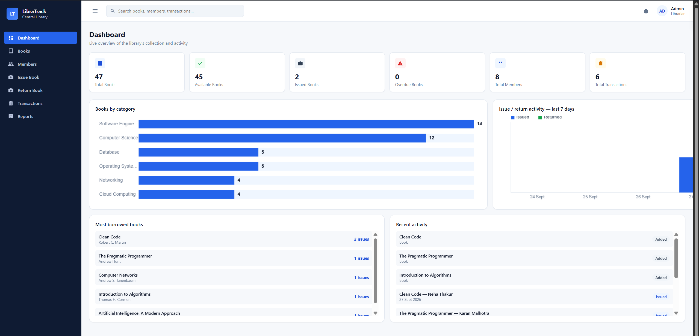
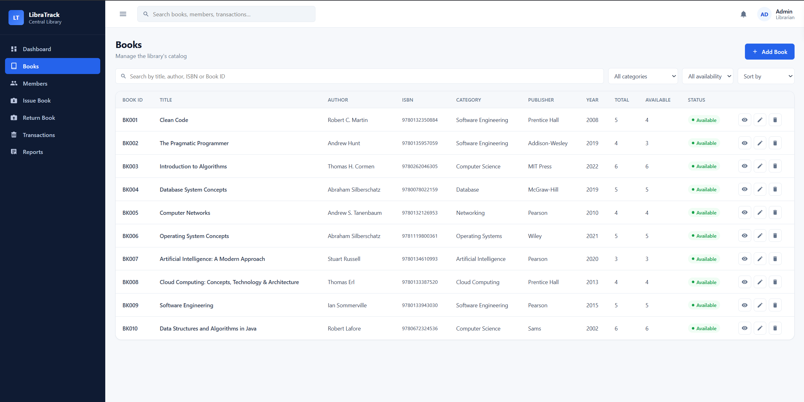
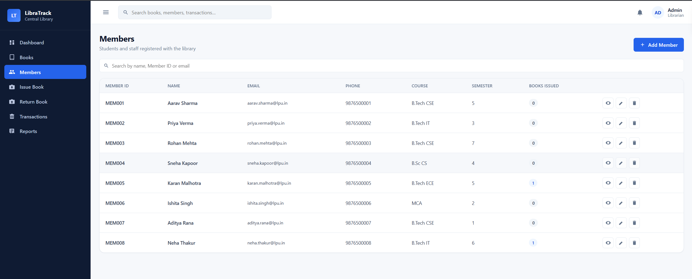
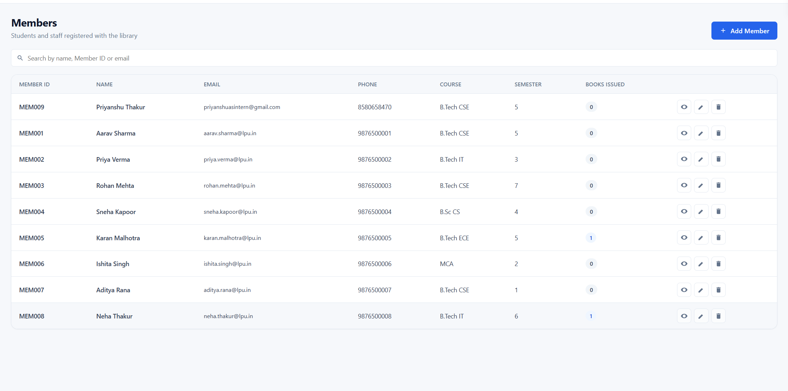
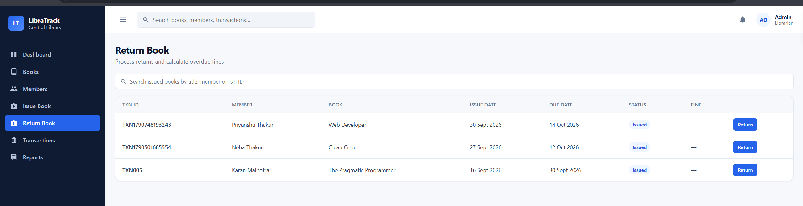
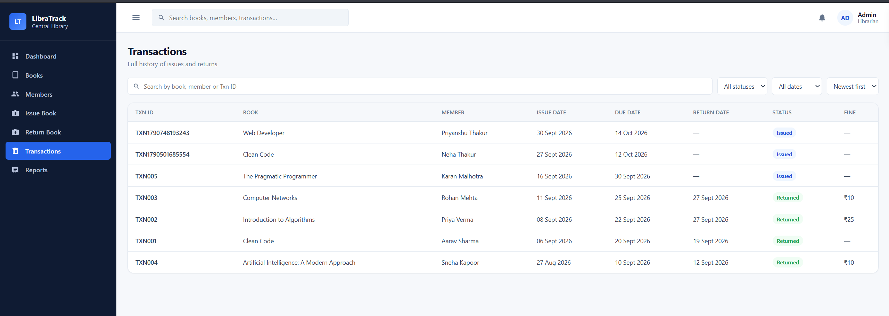
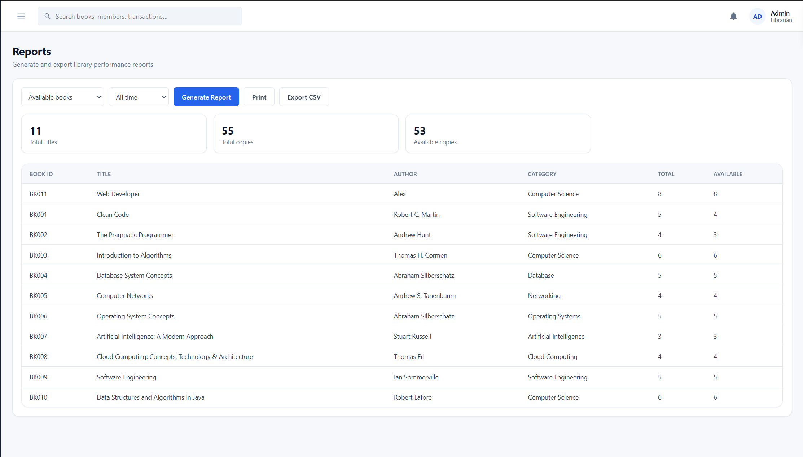
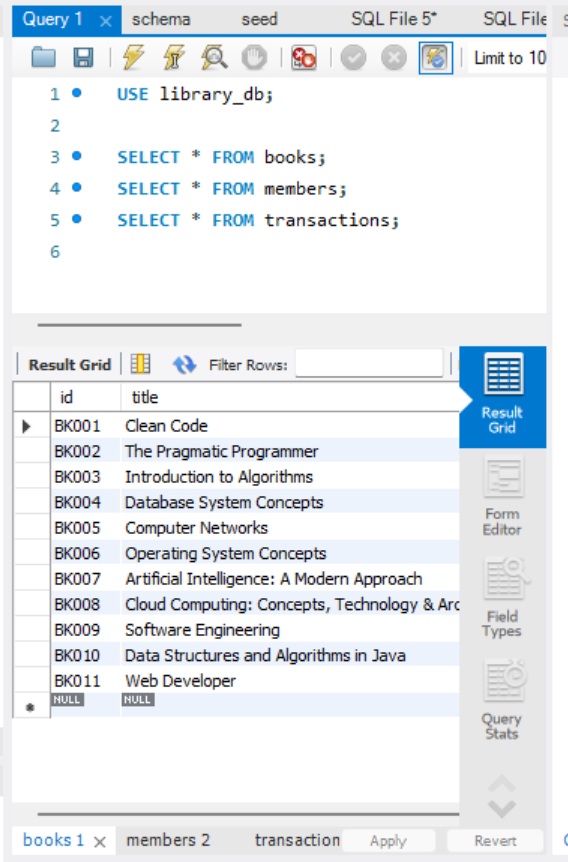
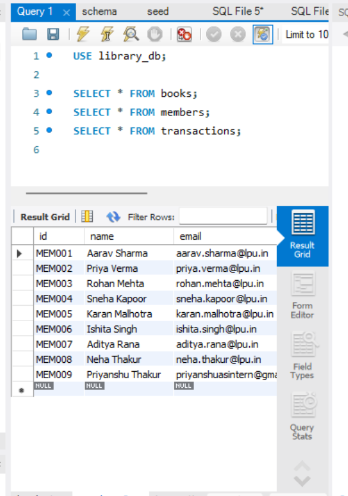
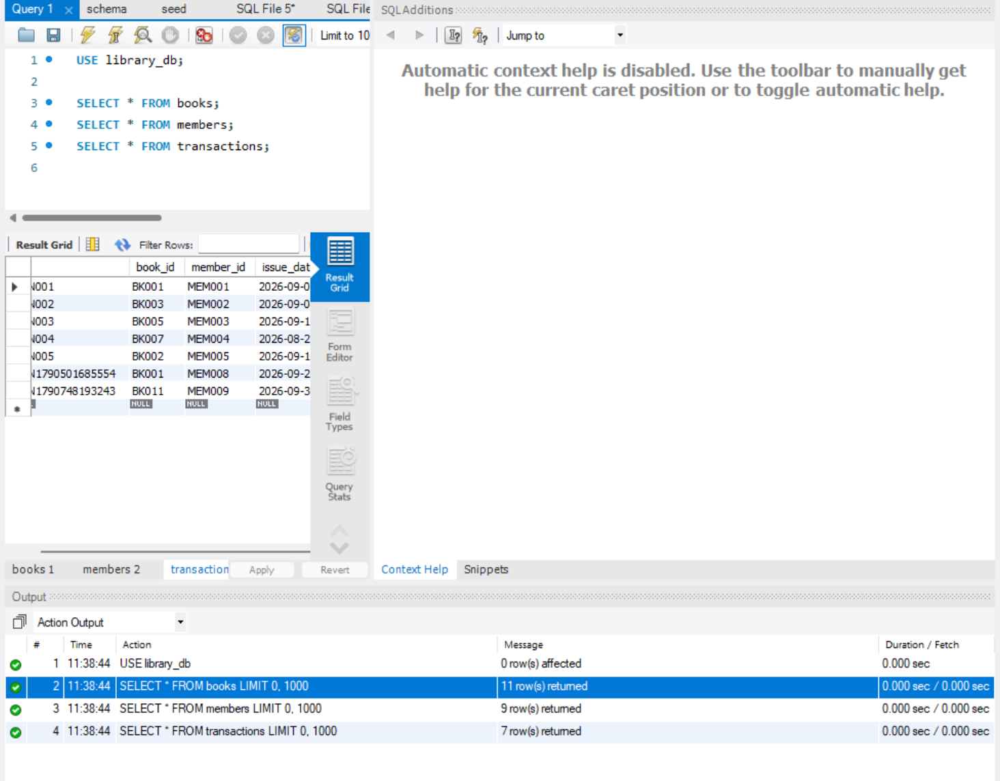

# Library Management System (LibraTrack)

A full-stack Library Management System to manage books, members and library transactions. Built as Task 2 of the Auspify Software Development Internship.

## Features

- Add, edit, view and delete books, with ISBN and duplicate validation
- Member management (a member with active issues cannot be deleted)
- Issue books with due dates and live availability check
- Return books with automatic fine calculation (₹5 per overdue day)
- Transaction history with status (Issued, Returned, Overdue), search and filters
- Dashboard with stats, category chart, 7-day activity chart and most borrowed books
- Reports (books, issued, overdue, returned, members, categories) with Print and CSV export
- MySQL database with a REST API built on Node.js and Express

## Tech Stack

- **Frontend:** HTML, CSS, JavaScript
- **Backend:** Node.js, Express.js
- **Database:** MySQL

## Project Structure

```text
library-management-system/
├── index.html, style.css, script.js     (frontend)
├── ScreenShots/
└── Server/
    ├── config/db.js
    ├── controllers/                     (books, members, transactions)
    ├── routes/                          (books, members, transactions)
    ├── schema.sql, seed.sql
    ├── .env.example
    └── server.js
```

## Setup

1. Clone the repository
```
   git clone https://github.com/priyanshuattri657/library-management-system.git
   cd library-management-system/Server
```
2. Install dependencies
```
   npm install
```
3. Create the database (make sure MySQL is running)
```
   mysql -u root -p < schema.sql
   mysql -u root -p library_db < seed.sql
```
4. Copy `.env.example` to `.env` and set your MySQL password (`DB_PASSWORD`)
5. Start the server
```
   npm run dev
```
6. Open `index.html` in your browser

> The frontend calls the API at `http://localhost:5000`, so the backend must be running before you open `index.html`.

The full list of API endpoints is in [Server/README.md](Server/README.md).

## Screenshots

### Dashboard


### Books


### Members


### Member Added


### Book Issue


### Return Book


### Transactions


### Reports


### Database




## Author

**Priyanshu Attri**
GitHub: [priyanshuattri657](https://github.com/priyanshuattri657) · LinkedIn: [priyanshuattri](https://linkedin.com/in/priyanshuattri)

#Auspify #AuspifyTechnologies #AuspifyInternship #AuspifyProjects